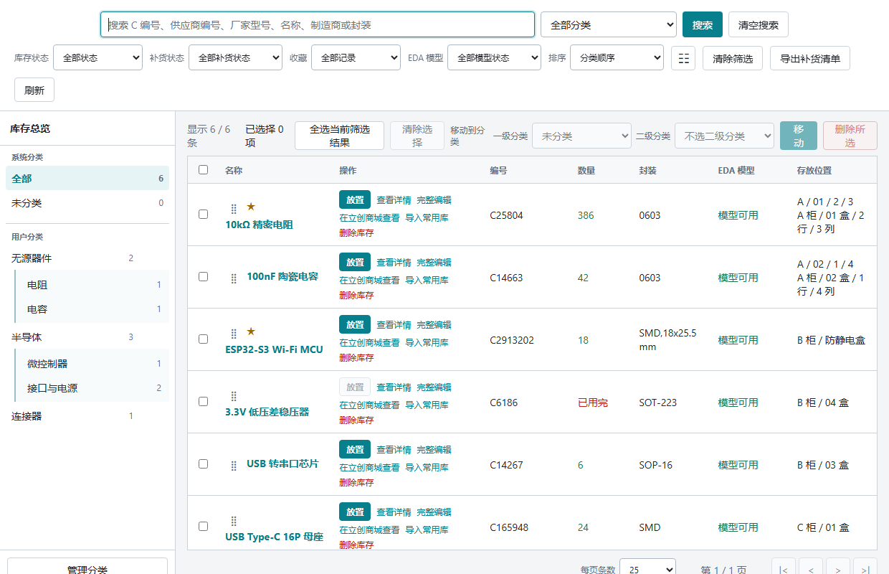
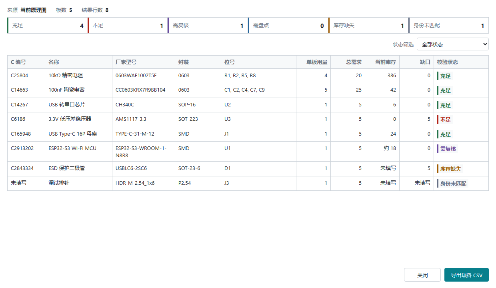
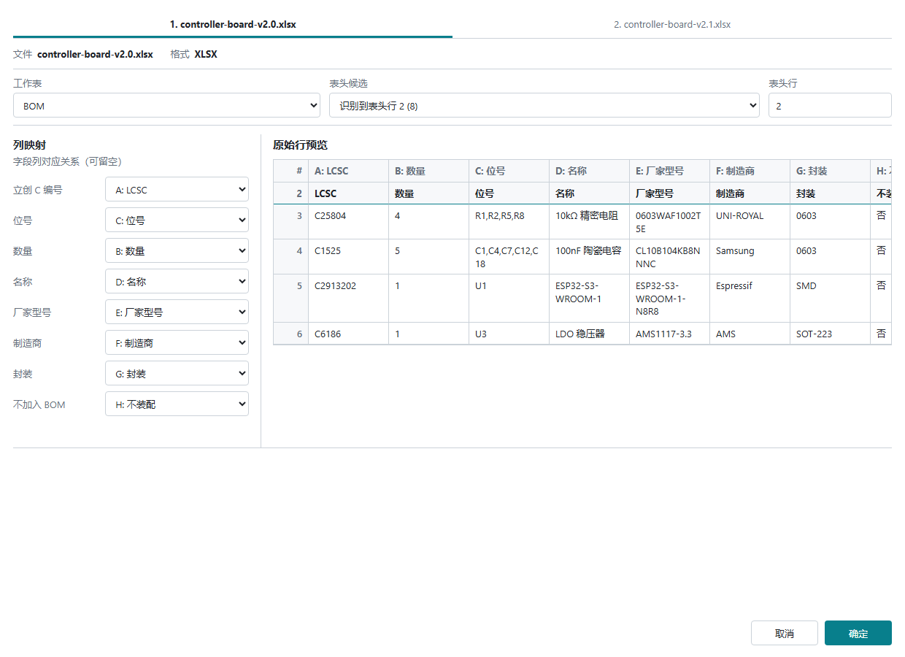

[简体中文](https://github.com/bluescola/jlceda-inventory/blob/main/README.md) | **English**

# JLCEDA Personal Component Inventory

## What This Extension Is For

JLCEDA Personal Component Inventory helps you record which components you have, where they are stored, and how many remain. It can check stock before design work or production, receive purchased parts, record BOM deductions, plan purchases, and back up your data.

The current release is `0.5.22`. It works with JLCEDA Professional V3, supports Simplified Chinese and English, and does not require you to run a server or database.

In this guide, a **bill of materials (BOM)** is a list of the components and quantities needed by a design. An **EDA component model** is the library data JLCEDA needs to place a part in a schematic; it is not the same as an LCSC marketplace product.

## Important Notes

- **The browser version and installed JLCEDA application keep separate inventories.** They do not synchronize automatically, even with the same account. Transfer data with a JSON backup file.
- **Placing a component does not reduce stock.** Use **Stock out by BOM batch** or edit the quantity yourself when parts are actually issued for production.
- **A scanner is optional.** You can paste the complete package QR-code text, and the extension does not access a camera.
- **Automatic backup is available only in the installed JLCEDA application.** The browser version still supports manual backup and restore.
- **The extension cannot read your LCSC account orders directly.** Export an order-detail file from LCSC and import that file.
- Workflows that change inventory show a preview or confirmation first. Cancelling them leaves inventory unchanged.

## Quick Start

1. Install and enable the `.eext` package in JLCEDA Professional V3.
2. Open **Component Inventory -> Inventory overview**.
3. Add parts by LCSC part number, as custom components, from an LCSC order file, or from a package QR code.
4. Add categories and storage locations, then set minimum stock levels for parts that need low-stock reminders.
5. Check the current design or an external BOM before production.
6. Create a manual JSON backup. In the installed JLCEDA application, also configure **Automatic backup settings**.

## Where Commands Are Available

All commands are under **Component Inventory**. The available design commands depend on the current JLCEDA workspace.

| Workspace | Design commands |
| --- | --- |
| Home | Inventory management, import, BOM, project planning, backup, and diagnostic commands. Open a schematic or PCB before saving its project demand. |
| Schematic | **Place from inventory**, **Locate selected component in inventory**, **Check current design stock**, and project-demand capture. |
| PCB | **Locate selected component in inventory**, **Check current design stock**, and project-demand capture. Placement is not available here. |

## Adding Components and Receiving Stock

### Add by LCSC Part Number

Entry: **Component Inventory -> Add by LCSC part number**.

Enter a C number such as `C25804`. The extension searches the JLCEDA built-in component library for a model that can be placed in a schematic. If one is found, its name, package, and related information are offered as suggestions; you decide which values to use.

If no model is found, the inventory record can still be saved, counted, categorized, and checked against a BOM. It simply cannot be placed directly in a schematic. The extension can open the official LCSC product page for manual verification, but it does not scrape marketplace pages.

### Add a Custom Component

Entry: **Component Inventory -> Add custom component**.

Use this for a part without a C number or when you want to maintain the information yourself. The name is required and the C number is optional. You can record a known count, an estimated count, or a quantity that has not yet been counted.

Filling in the form does not change inventory. Stock changes only after you choose **Save to inventory** or confirm that the new record should be merged with an existing one.

### Import an LCSC Order File

Entry: **Component Inventory -> Import order file**.

First export an order-detail `.xls` or `.xlsx` file from LCSC. Compatible CSV and JSON files are also accepted. The extension cannot download orders directly from your LCSC account.

Before saving anything, the preview shows the detected order number, quantities, possible duplicates, and how many records will be added, merged, or skipped. You also choose whether existing quantities should be increased, replaced by the order quantity, or left unchanged. The extension checks the order number and whether the same file was imported before.

Only confirmed files continue to component matching and inventory saving. The accepted CSV and JSON fields are listed in the [order import format](https://github.com/bluescola/jlceda-inventory/blob/main/docs/order-import-format.md).

### Import a Package Code

Entry: **Component Inventory -> Import package code**.

A scanner is optional. You can use either method:

1. Scan with a 2D QR-code scanner in HID keyboard mode, meaning the scanner enters text in the same way as a keyboard.
2. Read the QR code with another tool and paste the complete text into the input box.

The extension identifies the C number, manufacturer part number, and quantity, then asks you to check the original text and detected values. Confirming this step opens a form with the detected information already filled in. Inventory changes only after you save or merge that form.

A one-dimensional barcode scanner may not read the package QR code. The extension does not access a computer or phone camera.

## Managing Inventory

The **Inventory overview** is the main workspace for daily inventory work.

- Search by C number, manufacturer part number, name, manufacturer, or package.
- Filter by category, stock level, low-stock state, favorite state, and whether a placeable EDA model is available.
- Sort results, choose the number of rows per page, and select which columns are visible.
- Create up to two levels of categories and record cabinet, box, row, and column storage locations.
- View details, edit a record, mark it as depleted, move one or many records, or delete after confirmation.
- Set the quantity you want to keep on hand as the minimum stock level, then filter or export parts that need replenishment or a physical count.

Deleting a category does not delete its components; those records move to **Unclassified**. Importing categories from a JLCEDA personal or Favorites library creates missing category names but does not move inventory records. If JLCEDA cannot provide empty categories, only categories already used by library components can be imported.

The personal library means JLCEDA's own personal component library, not this extension's inventory list. An inventory record with a usable EDA model can be copied there without changing its inventory quantity.

If a new or edited C number or manufacturer part number appears to describe the same part as an existing record, the extension shows both records before you decide whether to merge them.

## Working with a Design

### Locate Selected Components

Entry in schematic and PCB workspaces: **Component Inventory -> Locate selected component in inventory**.

Select one or more components on the canvas first. The inventory overview then shows every matching record and separately lists design components that could not be linked to inventory. This command only finds records; it does not change stock.

### Check Current Design Stock

Entry in schematic and PCB workspaces: **Component Inventory -> Check current design stock**.

Enter the number of boards you plan to produce. The extension adds together the quantity needed for each part and reports which parts are sufficient, insufficient, missing from inventory, not counted yet, or unable to be matched. You can export the shortages as CSV.

This check does not deduct stock or create an order. If the current design cannot be read, use **Check external BOM stock** instead.

### Place from Inventory

Entry in a schematic: **Component Inventory -> Place from inventory**.

Choose an in-stock record with a usable EDA model. The component follows the mouse pointer until you click the schematic canvas to place it. Placement does not reduce inventory because the extension cannot confirm whether you completed the placement.

## BOM and Production

BOM files can be CSV, TXT, XLS, or XLSX. The extension identifies the worksheet and heading row, then lets you choose which column contains the C number, quantity, designator such as `R1` or `C3`, package, and do-not-place flag (DNP).

### Check an External BOM

Entry: **Component Inventory -> Check external BOM stock**.

Choose one BOM, confirm what each column means, and enter the number of boards. The result shows required quantities, current stock, and shortages and can be exported as CSV. Inventory is not changed.

### Compare BOM Versions

Entry: **Component Inventory -> Compare BOM versions**.

Choose two BOM files as the original and new versions. The report shows added or removed parts, quantity changes, and changes to C numbers, manufacturer part numbers, or other identifying information. Content that cannot be recognized is listed separately for review. The report can be filtered or exported and does not change inventory.

### Stock Out by BOM

Entry: **Component Inventory -> Stock out by BOM batch**.

Choose one BOM and review every planned deduction before confirming. The preview explains any missing record, unclear quantity, shortage, or unmatched part that prevents stock-out.

The batch either succeeds completely or changes nothing. Every part must match an inventory record with a known, sufficient quantity. If any part fails a check, no inventory is deducted. When the same parts and quantities are submitted again, the extension warns about a possible duplicate; continue only when this really is a new production batch.

### Stock-Out and Reversal History

Entry: **Component Inventory -> BOM stock-out and reversal history**.

This page lists BOM stock-out batches and their reversal records. A batch that has not been reversed can be reversed as a whole, which restores every deducted quantity and saves a corresponding reversal record. A reversed batch cannot be reversed again.

This history covers BOM stock-out and reversal only. It is not a complete history of normal edits, package-code receipt, or order import.

## Projects, Procurement, and Substitutes

### Saved Design Demand

Entry: **Component Inventory -> Project demand and procurement**. Open a schematic or PCB before choosing **Capture current design**.

The extension can save the parts and quantities required by the current design as a design demand record. Give each record a name and production board quantity. When the same design is saved again, you see the differences before replacing the old demand.

This workflow can save only the current schematic or PCB, not an external BOM. If the schematic and PCB describe the same physical board, saving both records counts the demand twice, so keep only the one you intend to use.

### Procurement Suggestions

The extension combines all saved demand records, compares the total with inventory, and calculates a suggested purchase quantity. It separates parts that are sufficient, insufficient, not counted yet, or missing from inventory. Suggestions can be exported as CSV.

### Purchase Records

Purchase records let you manually enter the quantity, platform, order number, date, currency, and price. Enter prices in the smallest currency unit: for `CNY`, enter `125` for CNY 1.25. Totals are grouped by currency.

Saving a purchase record does not increase inventory. When the parts arrive, receive them through normal add, order import, or package-code import.

### Substitute Parts

Entry: **Component Inventory -> Manage substitute links**.

Choose the part you originally intended to use, then manually confirm which inventory parts can replace it. The entered demand quantity only helps rank candidates by available stock. Substitute links never change BOM matching, stock checks, deductions, or quantities automatically.

## Backup, Transfer, and Restore

Inventory is stored in data space that JLCEDA provides to the extension; no separate database is required. JLCEDA in a browser and the installed JLCEDA application each keep their own inventory. Changes do not synchronize automatically.

### Manual Backup

Entry: **Component Inventory -> Save inventory backup as**.

This saves a complete `.json` backup file through the JLCEDA save dialog. It works both in the browser and in the installed application and does not change current inventory.

### Automatic Backup in the Installed Application

Entry: **Component Inventory -> Automatic backup settings**.

Automatic backup works only in the installed JLCEDA application and requires the **Allow external interaction** permission so the extension can choose a folder and write a backup file. After you choose a folder, the extension tests it before enabling backup and then keeps `jlceda-inventory-latest.json` updated.

Only the latest backup is kept. If the folder or permission becomes unavailable, current inventory remains saved and a backup warning is shown.

### Restore or Transfer Inventory

Entry: **Component Inventory -> Restore inventory backup**.

Choose an external `.json` backup or the old inventory copy that the extension automatically saved before the previous restore. The extension checks that the file is compatible, complete, and within the supported size, then shows how many records it contains before asking for confirmation.

Restore replaces all current inventory data; it does not add or merge only a few records. Inventory, categories, order-import history, BOM stock-out and reversal history, project demand, purchases, and substitute links are all replaced. Save a new backup first if you may need the current data later.

To move data between the browser and installed application:

1. Choose **Save inventory backup as** where the current inventory is stored.
2. Move the `.json` file to the other environment.
3. Choose **Restore inventory backup**, review the summary, and confirm replacement.

## Diagnostics and Version

- **View diagnostic logs** shows recent operation states and error categories without changing inventory.
- **Export diagnostic logs** saves a diagnostic JSON file that can be attached to a problem report.
- **About inventory extension** shows the installed version and basic information.

## File Limits

| Input | Supported formats | Limits |
| --- | --- | --- |
| Order import | XLS, XLSX, CSV, JSON | Up to 100 files, 10 MB per file, and 50 MB in total |
| External BOM check or stock-out | CSV, TXT, XLS, XLSX | 1 file, up to 10 MB |
| BOM version comparison | CSV, TXT, XLS, XLSX | Exactly 2 files, up to 10 MB each |
| Package QR text | Pasted text or text entered by a HID keyboard scanner | Up to 4,096 characters; requires a valid C number and a positive whole-number quantity |
| Inventory backup | JSON | Up to 10 MB and 10,000 inventory records; restore replaces all current data |

One Excel file can contain up to 32 worksheets, 128 columns per worksheet, and 10,000 data rows per worksheet. Oversized files are rejected before import starts.

## Frequently Asked Questions

### Do I need a scanner for package-code receiving?

No. Paste the complete QR-code text, or use a 2D scanner that enters text like a keyboard. The extension does not access a camera.

### Why can I save a C-number part but not place it?

The LCSC product can be saved as inventory even when JLCEDA has no usable EDA model for it. Placement additionally requires an available model, positive stock, and an open schematic.

### Does placing or checking a component reduce stock?

No. Stock changes only after an explicit save, edit, delete, merge, order import, BOM stock-out, reversal, or complete restore.

### Does inventory synchronize between the browser and installed application?

No. They keep separate inventories. Use **Save inventory backup as** and **Restore inventory backup** to transfer a `.json` file.

### Can the extension download my LCSC orders automatically?

No. Export an order-detail file from LCSC and import it through **Import order file**.

### Can restore merge only a few records?

No. Restore replaces all current data with the backup. Use normal add, merge, or order import when you only want to receive more stock.

### What should I do when a command is unavailable or fails?

Confirm that you are in the correct Home, schematic, or PCB workspace and that any requested file or **Allow external interaction** permission is enabled. Then use **View diagnostic logs** or **Export diagnostic logs** when reporting the problem.

## Installation and Updates

1. Get `jlceda-inventory_v0.5.22.eext` from the JLCEDA extension marketplace or a GitHub Release.
2. Open JLCEDA Professional V3.
3. Go to **Advanced -> Extension Manager -> Import** and select the `.eext` file.
4. Enable the extension under **Installed**. Enable **Show in top menu** if you want the menu kept in the top row.
5. Open **Component Inventory -> Inventory overview**.

Before updating, create a manual JSON backup. Import the new `.eext` package as an update without deleting the existing extension data.

## Developer Documentation and License

Build commands, architecture, data-safety rules, platform adaptation, testing, and the release checklist are maintained in the [developer guide](https://github.com/bluescola/jlceda-inventory/blob/main/docs/development-guide.md).

Contributions and implementation credits are listed in [CONTRIBUTORS.md](https://github.com/bluescola/jlceda-inventory/blob/main/CONTRIBUTORS.md).

The source code, original extension logo, and demonstration screenshots are released under the [Apache License 2.0](https://github.com/bluescola/jlceda-inventory/blob/main/LICENSE). The three screenshots use fictional demonstration data.
